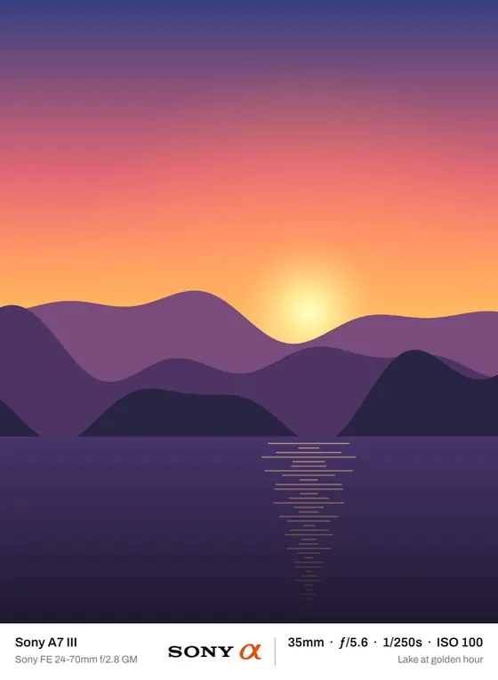
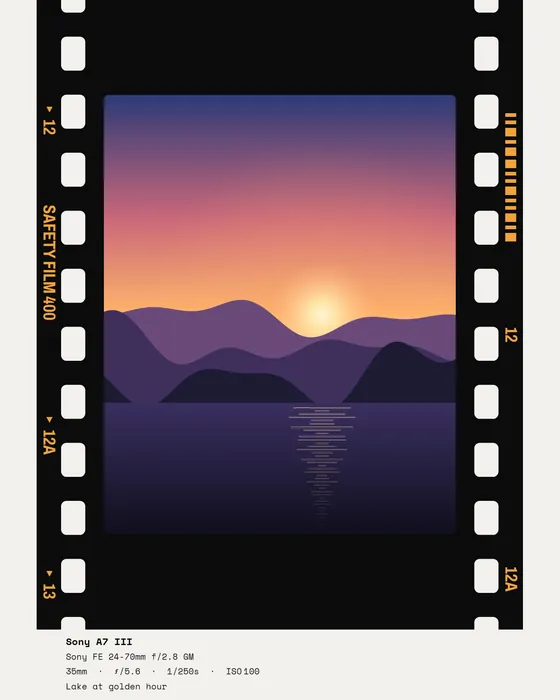
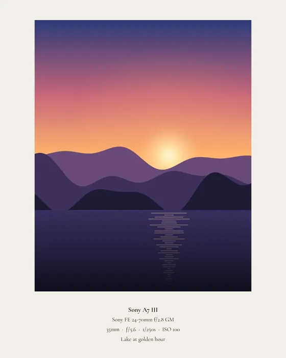
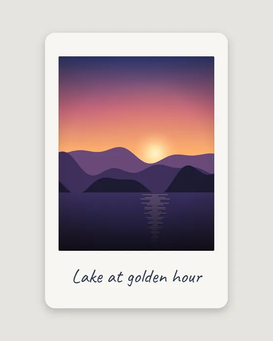
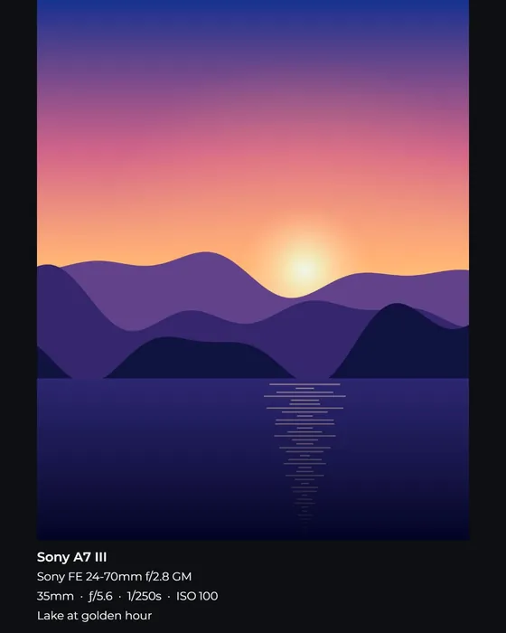

# MinimalFrame

**Frame a photo and post it in seconds.** Clean borders, film frames, captions with your camera details, carousels and photo dumps, plus a film-style photo editor. Everything runs on your device, in the browser or as an Android app. Your photos are never uploaded.

[](https://svelte.dev)
[](https://vitejs.dev)
[](#get-it)
[](#android-app)
[](LICENSE)
[](https://github.com/erenalsan/minimalframe/releases/latest)

**[⬇ Download for Android (APK)](https://github.com/erenalsan/minimalframe/releases/latest)**  ·  [Install it](#android-app)

**Languages:** English · Türkçe · Deutsch  ·  **Themes:** light, dark or the device's own

<p align="center">
  
  
  
  
  
</p>

---

## How it works

1. **Open** one photo or a whole shoot (JPEG, PNG, WebP, HEIC or RAW), or share photos to MinimalFrame from your gallery.
2. **Pick a frame.** Every frame shows your photo, so you see the result before you tap.
3. **Save or share.** The framed photo lands in your gallery at full quality, or goes straight to Instagram and other apps.

Editing is there when you want it, and out of the way when you don't.

---

## Features

### Frames
- **Ready-made frames:** Gallery, Museum mat, Feed square, Midnight, Editorial, Kraft, Cinema, Brand bar, Spread and Story poster.
- **Film frames:** a 35 mm strip with sprocket holes and edge print, an instant print with a handwritten line, a darkroom print and a slide mount.
- **Shapes for every feed:** portrait 4:5, square, Story and Reel 9:16, print 3:2, wide 16:9, photo with caption, or an even border.
- **Your own frames:** save any setup as a template, then back it up or move it to another device as a file.
- **Colours:** quick picks, colours taken from the photo, automatic text contrast and saved colour pairs.
- **Logo or signature** as a watermark, with corner positions, size and opacity.

### Captions
- **Camera details** (camera, lens, focal length, aperture, shutter, ISO and date) are read from the photo and can be edited per photo.
- **Readable camera names:** codes such as `ILCE-7RM4`, `XF35mmF2` or `SM-S931B` become *Sony A7R IV*, *XF 35mm f/2* and *Galaxy S25*.
- **Location:** the place where the photo was taken (for example *Passau, Germany*), from the photo's own details or looked up from its GPS position. It works offline too, showing the coordinates instead.
- **Layouts:** stacked lines, a brand bar with the real camera-maker logo, or one slim row spread across the bottom.
- **Fonts:** eight bundled fonts that work offline, the fonts on your computer, or your own font file.

### Carousels and photo dumps
- **Seamless carousels:** one wide photo split into 2–10 slides that join up when people swipe. Drag the photo to choose which part fills the strip.
- **Photo dumps:** several photos as one post, one per slide, in pairs or as a grid of four. Hold and drag to change the order.
- **Cover slide:** every photo of the dump on a contact sheet, with a title you type or one made for you.
- Slides are named in posting order (`MinimalFrame_2026-10-29_01of04`), so they upload in the right order.

### Editing
- **Looks:** one-tap film looks, an **Auto** look worked out for each photo, and your own saved looks.
- **Fujifilm recipes:** paste a recipe's settings text, or share it to the app, and it becomes a look.
- **LUTs:** import `.cube` files and blend them in with a strength slider.
- **Match look:** makes one photo's brightness, white balance, contrast and colour follow another photo.
- **Light and colour:** exposure, contrast, highlights, shadows, whites, blacks, temperature, tint, vibrance and saturation.
- **Tone curve** per channel, and a **colour mixer** for the hue, saturation and brightness of eight colour bands.
- **Detail and film:** clarity, sharpening, grain and soft bloom.
- **Crop:** free or fixed shapes, straighten, rotate and flip.
- **Fast:** the photo is developed on the graphics chip (WebGL2), so sliders update live, even on mid-range tablets. Exports are rendered again at full resolution.

### Saving and sharing
- **Sizes:** Instagram size, 2K, 4K or full size, as JPEG, PNG or WebP, with an estimate of the file size.
- **Batch:** tick the photos you want and save them together. Phones and tablets get separate images in the gallery; computers get one ZIP.
- **Share straight to apps** from the Export sheet.
- **Style codes:** share your whole look and frame as a short code (`MF1.…`). Whoever pastes it, or shares it to the app, gets the same style in one tap.

### Phone and tablet
- **Gestures:** pinch or double-tap to zoom, swipe between photos, hold to see the original, pull the tool panel down to close it, double-tap a slider to reset it.
- **Back** closes the open panel, sheet or photo first, and only then leaves the app.
- **Motion that follows your finger:** the photo area grows and shrinks with the tool panel, frames morph into one another, and saved photos turn like pages.
- **Smooth on mid-range devices:** costly effects step aside while things move. Tested on a Galaxy S25 and a Galaxy Tab S9 FE+.

### Your work is kept
Photos you're working on come back after the app is closed, including originals, edits, crops, captions and the frame. Photos you've already saved or shared, and not changed since, don't come back: the app opens ready for the next photo. Everything is stored only on the device.

---

## Privacy

- **Your photos never leave the device.** Developing, framing and exporting all happen on the phone or computer.
- **Clean files by default:** exports carry no metadata, so there's no serial number, camera data or GPS. Turn **Remove metadata** off to keep camera, lens and settings in JPEGs. The GPS position is always removed.
- **The one online request:** when *Show location* is on and a photo has a GPS position but no place name, its position, rounded to about 100 m, is sent to [OpenStreetMap Nominatim](https://nominatim.org) to find the place name. The answer is cached on the device. With the option off, or without internet, nothing is sent.
- No accounts, no analytics, no ads.

The full details are in the [privacy policy](PRIVACY.md).

---

## Get it

### In the browser
MinimalFrame is a Progressive Web App. Open it in Chrome, Edge or Samsung Internet and choose **Install** (or **Add to Home screen**). It then opens like an app, works offline, and appears in the gallery's share menu.

### Android app
The Android app (Capacitor) adds what a browser can't do:

- saves straight into a **MinimalFrame** album in the gallery;
- a **Saved photos** screen to look through, share again or delete what you've exported (Android 10 and later);
- opens photos, Fujifilm recipes and style codes shared from other apps;
- shares through Android's own share menu.

**Install:** download `MinimalFrame-0.1.0.apk` from the [latest release](https://github.com/erenalsan/minimalframe/releases/latest) on your phone and open it. If Android asks, allow your browser or Files app to install apps. Android 7.0 or newer. To build it yourself, see [Android](#android).

---

## Development

Requires [Node.js](https://nodejs.org/) 20 or newer.

```bash
git clone https://github.com/erenalsan/minimalframe.git
cd minimalframe
npm install
npm run dev        # http://localhost:5173
```

| Command | What it does |
|---|---|
| `npm run dev` | Development server with hot reload |
| `npm run build` | Production build into `dist/`, including the offline service worker |
| `npm run preview` | Serves the production build locally |
| `npm test` | Unit tests: frame layout, geometry, colour, LUTs, recipes, camera names, film frames, photo dumps, location, style codes and translations |

To check frame rates on a real device, add `?fps` to the address. A small meter shows frames per second and late frames.

### Android

Also needs the [Android SDK](https://developer.android.com/studio) and JDK 21 (the one bundled with Android Studio works).

```bash
npm run build
npx cap sync android
cd android
./gradlew assembleDebug          # → app/build/outputs/apk/debug/app-debug.apk
adb install -r app/build/outputs/apk/debug/app-debug.apk
```

Or open the `android/` folder in Android Studio and press **Run**.

**Release build.** Release APKs are signed with a key kept outside the repo. Put its location and passwords in `android/keystore.properties` (ignored by Git):

```
storeFile=C:/path/to/minimalframe-release.jks
storePassword=…
keyAlias=minimalframe
keyPassword=…
```

Then `./gradlew assembleRelease` gives a signed, shrunk `app/build/outputs/apk/release/app-release.apk`. For each new release, raise `versionCode` by one and set `versionName` in `android/app/build.gradle`. The app's own Android code lives in `android/app/src/main/java/com/eren/minimalframe/`:

| File | What it does |
|---|---|
| `GalleryPlugin.java` | Saves exports to the MinimalFrame album; lists, shares and deletes them for Saved photos |
| `IncomingPlugin.java` | Photos, recipes and style codes shared to the app |
| `MainActivity.java` | Registers the plugins; Back closes what's open in the app before leaving it |

### Project layout

```
src/
  App.svelte              workbench: state, rendering, gestures, export, last session
  components/             landing page, export sheet, photos tray, saved photos, pickers
  components/tools/       one component per tool panel
  lib/                    logic and engines (each with a *.test.js where it matters)
    frameLayout.js        border, caption and carousel layout, shared by preview and export
    film.js               film frames and the contact-sheet cover
    dump.js               photo dump slides
    developEngine.js      WebGL2 develop engine
    rawEngine.js          LibRaw (WebAssembly) RAW decoding
    exifCleaner.js        camera and lens codes → readable names
    locationHelper.js     place names: from the photo, OpenStreetMap, or coordinates offline
    styleCode.js          shareable MF1 style codes
    i18n.svelte.js        interface language; locales/ holds Turkish and German
    theme.svelte.js       light, dark or automatic theme
    store.js              IndexedDB storage for fonts, LUTs and the last session
public/                   icons, brand logos, landing images, share-target worker
android/                  the Capacitor Android app
```

### Translations

The English text is the key: `t("Export")` gives the Turkish or German version from `src/lib/locales/`, and falls back to English when one is missing. `npm test` fails if any text in the app lacks a Turkish or German version, or if the `{placeholders}` differ. To add a language, add a locale file and an entry in `LANGUAGES` in `i18n.svelte.js`.

---

## Roadmap

### First release (0.1.0)
- [x] App icon and splash screen
- [x] An animated first landing page
- [x] Version 0.1.0, a signed release APK on [GitHub Releases](https://github.com/erenalsan/minimalframe/releases/latest)
- [x] Privacy page: [PRIVACY.md](PRIVACY.md)

### Ideas for later
- **Google Play** release.
- **Open `.cube` files shared from other apps**, the way recipes and style codes already arrive.
- **Apply to all:** give every open photo the current look in one tap, keeping each photo's own crop.
- **Lighter preview while dragging** on low-end phones: draw a smaller preview during the drag and the full one on release.
- **Style codes as QR codes**, to pass a look on from one phone to another in person.
- **Caption templates:** save the caption's lines and order, for example *camera · lens* then *place · date*.
- **More languages:** Spanish, French, Italian and Japanese are the most-asked photo-community languages.
- **iOS app** from the same code (Capacitor), saving into a Photos album.

---

## Stack

| | |
|---|---|
| Interface | [Svelte 5](https://svelte.dev) (runes) |
| Build | [Vite 8](https://vitejs.dev), [vite-plugin-pwa](https://vite-pwa-org.netlify.app) |
| Android | [Capacitor 8](https://capacitorjs.com) with two small native plugins |
| Image engine | WebGL2 shaders, Canvas 2D |
| RAW | [libraw-wasm](https://www.npmjs.com/package/libraw-wasm) |
| HEIC | [libheif-js](https://www.npmjs.com/package/libheif-js) (LGPL-3.0, see `public/licenses/`) |
| EXIF | [exifr](https://github.com/MikeKovarik/exifr) |
| Place names | [OpenStreetMap Nominatim](https://nominatim.org) (only with *Show location* on) |
| ZIP | [JSZip](https://stuk.github.io/jszip/) |
| Fonts | [Fontsource](https://fontsource.org) (bundled, offline) |

---

## Licence

MinimalFrame is released under the [MIT licence](LICENSE): you're free to use, change and share it, as long as the copyright notice stays with it. Third-party licences are in `public/licenses/`. Map data © [OpenStreetMap](https://www.openstreetmap.org/copyright) contributors.
